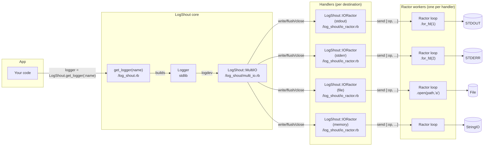
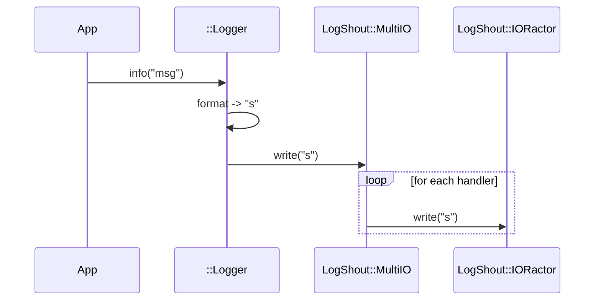

# LogShout

Fan-out logging for Ruby using Ractors. LogShout wraps Ruby's `::Logger` to write each log message to multiple destinations (stdout, stderr, files, in-memory) concurrently and safely.

## WARNING

Ractor support in Ruby is EXPERIMENTAL use at your own risk.

## Installation

Add to your Gemfile and bundle:

```ruby
gem "log_shout", path: "." # or the released version when published
```

```bash
bundle install
```

## Quick start

1. Optionally create a `log_shout.yml` alongside your app (or set `LOG_SHOUT_CONFIG_PATH`). If you skip this, LogShout will run with sane defaults (documented below). If you specify `LOG_SHOUT_CONFIG_PATH` and the file does not exist you will get a runtime error.

```yaml
---
defaultLevel: info
defaultHandlers: [stdout]
extraHandlers:
  app_file_log:
    type: file
    path: ./app.log
loggers:
  app:
    level: debug
    handlers: [stdout, app_file_log]
```

2. Use LogShout in your code:

```ruby
require "log_shout"

logger = LogShout.get_logger(:app)
logger.info("Hello from LogShout")
# in your console
# [2025-10-04 10:50:55.514722 #583620/583642] I -- app: Hello from LogShout
```

Tip: include the helper to get class/instance-level loggers.
This will provide access to a logger named after the class via both a class and instance method named logger.

```ruby
module MyModule
  class MyClass
    include LogShout::Helper

    def self.class_method
      logger.debug("my message")
    # [2025-10-04 10:50:55.514722 #583620/583642] D -- MyModule::MyClass: my message
    end

    def method
      logger.debug("my message")
    # [2025-10-04 10:50:55.514722 #583620/583642] D -- MyModule::MyClass: my message
    end
  end
end

```

Tip: Run a job in its own Ractor with a Ractor safe logger
This behavior is similar to the class based helpers but the API is different.

If you have the following class

```ruby
class MyJob
  def self.run(logger, p1, p2)
    logger.debug("some background task #{p1} #{p2}")
    p1+p2
  end
end
```

Then you can run the job as follows.

```ruby
r = LogShout::LoggingRactor.start(target: MyJob, name: :app, args: [1, 4])
# [2025-10-04 10:50:55.514722 #583620/583642] D -- MyJob: some background task 1 4
r.value # 5
```

## Configuration

### Schema

- defaultLevel: info|debug|warn|fatal
- defaultHandlers: [stdout] # array of handler names that every logger inherits by default.
- extraHandlers: map of name -> `{ type: stdout|stderr|file|memory, path?: string }` (file requires path).
- loggers: map of logger name -> `{ level: string, handlers: [names...] }`.

Notes:

- Built-in handlers `stdout` and `stderr` cannot be overridden. eg. you cannot create a **new** handler named `:stdout`

## Using without a config file (defaults)

The configuration file is optional. These are the defaults.

```yaml
---
defaultLevel: INFO
defaultHandlers: [stdout]
extraHandlers: {}
loggers: {}
```

Runtime behavior of default config:

- If you set `LOG_SHOUT_CONFIG_PATH` and that file doesn’t exist, `configure` will raise.
- Any logger name you request (e.g., `get_logger(:anything)`) uses the default level and handlers when not explicitly configured.
- By default only `stdout` is attached; to add `stderr`, `file`, or `memory`, define them in `extraHandlers` and reference by name in a logger’s `handlers`.

Minimal example with defaults (no file present):

```ruby
require "log_shout"
LogShout.get_logger(:any).info("goes to STDOUT at INFO level")
```

## Architecture: Logger I/O

This shows how log messages flow from your code through Ruby’s `::Logger`, across `MultiIO`, into per-destination Ractors, and finally to underlying IOs.

Key parts:

- `LogShout.get_logger` in [lib/log_shout.rb](lib/log_shout.rb): builds `::Logger` with a custom logdev and default formatter.
- `LogShout::MultiIO` in [lib/log_shout/multi_io.rb](lib/log_shout/multi_io.rb): fan-out logdev that forwards `write/flush/close` to all handlers.
- `LogShout::IORactor` in [lib/log_shout/io_ractor.rb](lib/log_shout/io_ractor.rb): one ractor per handler; owns the actual IO (STDOUT/ERR/File/StringIO).
- `LogShout::LoggingRactor` in [lib/log_shout/logging_ractor.rb](lib/log_shout/logging_ractor.rb): helper to run a job in its own ractor with a ready-to-use logger.
- Default formatter in [lib/log_shout/formatters/default.rb](lib/log_shout/formatters/default.rb).

`LogShout::IORactor` objects are pre-created for all handlers defined. These objects are shared between all loggers that are created. So if you create 20 loggers with the same handler, only one `LogShout::IORactor` will exist, and thus only one Ractor will be created.

### Component view



### Sequence view (write/flush/close)



## Dev setup(with nix+direnv)

```bash
direnv allow
bundix
```
